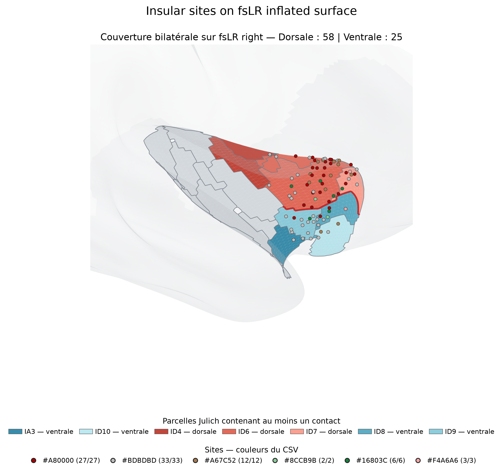

# Insula MNI152 Plotter — V13

Projet Python pour projeter les 83 contacts iEEG MNI152 fournis sur la surface insulaire Julich-Brain / fsLR, en utilisant les sélections manuelles dorsal/ventral déjà présentes dans le CSV de résultats.


## Aperçu

Visualisation des 83 contacts iEEG projetés sur la surface insulaire fsLR 32k, avec leur répartition sur les deux hémisphères.



## Ce qui change en V13

### Placement Julich guidé par le groupe dorsal/ventral

`data/sites_user.csv` contient les colonnes d'origine (`site_id`, `label`, `x`, `y`, `z`, `color`, `t_value`) ainsi que deux annotations provenant du fichier de résultats fourni :

- `insula_area_for_dv` : région reportée pour chaque site.
- `insula_dv_group` : groupe dorsal ou ventral à respecter lors du placement sur la surface.

Effectifs de l'entrée : **58 Dorsale, 25 Ventrale, 83 au total**.

Après l'étape de projection MNI152 → fsLR, le code vérifie si le sommet candidat appartient au groupe D/V demandé. Sinon, il choisit le sommet Julich le plus proche parmi les parcelles du même groupe et du même hémisphère, sans seuil maximal de 6 mm. Les distances et méthodes sont consignées dans `surface_snap_distance_mm` et `projection_method`.

Cette opération est un placement de visualisation guidé par la sélection manuelle D/V. Elle ne corrige pas les coordonnées MNI et ne remplace pas une localisation individuelle CT/T1-FreeSurfer. La distance est euclidienne dans le maillage fsLR gonflé, et non une distance géodésique sur le cortex natif.

Si aucun candidat cortical fsLR ne peut être obtenu même après les rayons de secours jusqu'à 40 mm, le contact reste explicitement signalé non projeté : sans candidat de surface, il n'est pas possible de définir de façon fiable le sommet Julich le plus proche.

### Séparation des contacts superposés

Le fichier de projection fourni contenait trois paires de contacts partageant exactement le même sommet fsLR :

- S08 / S59 — sommet 11126, droite
- S17 / S38 — sommet 10833, droite
- S39 / S55 — sommet 10868, droite

Dans les figures, **les deux membres de chaque paire sont maintenant décalés** symétriquement dans le plan tangent local. Le décalage est uniquement graphique : les sommets et coordonnées `surface_*` ne changent pas. La flatmap applique également une séparation 2D aux points exactement superposés.

Paramètres dans `config.yaml` :

```yaml
plot:
  overlap_detect_distance_mm: 0.80
  overlap_offset_mm: 1.55
  overlap_tangent_neighborhood_mm: 5.0
```

- `overlap_detect_distance_mm` : distance entre points sous laquelle ils sont considérés comme superposés.
- `overlap_offset_mm` : rayon du décalage ; les deux points d'une paire sont placés de part et d'autre du centre.
- `overlap_tangent_neighborhood_mm` : voisinage utilisé pour estimer le plan tangent local.

## Fichiers importants

- `data/sites_user.csv` : entrée active, 83 sites et annotations manuelles D/V.
- `data/sites_surface_coordinates_v12_reference.csv` : fichier de résultats précédent fourni, gardé à titre de référence.
- `outputs/sites_surface_coordinates.csv` : nouvelles coordonnées et projection fsLR, avec la région Julich sur la surface et les distances de snap.
- `outputs/site_display_positions.csv` : coordonnées de base et positions graphiques après écartement des points superposés (`display_offset_mm`).
- `outputs/overlapping_sites_report.csv` : paires/groupes partageant un sommet de départ.
- `outputs/site_visibility_report.csv` : audit site par site de la présence dans les figures.
- `outputs/site_counts_dorsal_ventral.csv` : nombres par hémisphère et groupe.

Les figures existantes de la V12 sont conservées : vue oblique fusionnée, vue bilatérale, dorsal/ventral fusionné, figures avec colorbar `t_value`, vues aplaties et export Connectome Workbench.

## Installation dans l'environnement Conda actuel

Dans PowerShell, depuis le dossier extrait :

```powershell
conda activate insula-plot
cd chemin\vers\insula_mni152_plotter_v13
python -m pip install -e . --no-deps --upgrade
python scripts\run_plot.py --config config.yaml
```

`--no-deps` évite que pip mette à jour NumPy, SciPy, Matplotlib, NiBabel, neuromaps ou siibra dans l'environnement existant. Aucune nouvelle dépendance n'est ajoutée en V13.

Le premier lancement a besoin d'un accès Internet pour télécharger les ressources fsLR et Julich-Brain. La projection de l'atlas probabiliste est ensuite mise en cache dans `outputs/julich_probability_wta_fslr_32k.npz`.

## Tests

```powershell
python -m pytest -q
```

La suite hors ligne contient 22 tests, dont des tests du snap D/V sans cutoff de 6 mm et du décalage symétrique des deux contacts d'une paire superposée.

## Limite méthodologique

La projection part de coordonnées MNI152 puis utilise la surface standard fsLR. Elle diffère de la chaîne de l'article Huang et al. fondée sur la localisation individuelle CT/T1, la reconstruction FreeSurfer et l'enregistrement de surface. Les contacts ayant un snap de grande distance doivent être interprétés comme des positions de visualisation contraintes par l'annotation D/V manuelle, et non comme une correction anatomique indépendante.
